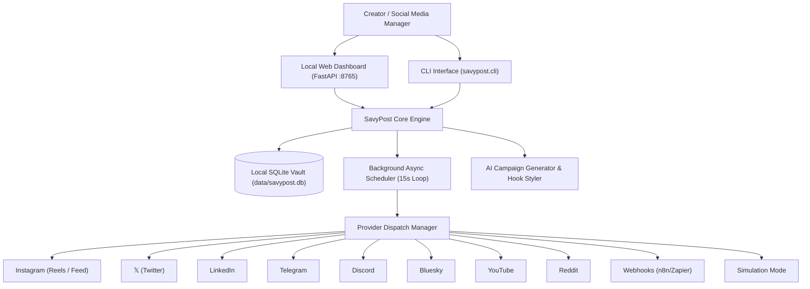

# SavyPost 🚀

> **Open-Source Local AI Social Media Manager & Multi-Channel Cross-Publisher.**  
> Built for creators, developers, and founders who want full data privacy, zero subscription fees, and automated multi-channel publishing running directly from their own machine.

[](LICENSE)
[](https://python.org)
[](https://fastapi.tiangolo.com)
[]()

---

## 🌟 Why SavyPost?

Traditional social media schedulers (Buffer, Hootsuite, Sprout Social) lock scheduling behind expensive monthly tiers, upload limits, and store your tokens on remote cloud databases. 

**SavyPost** is completely local:
- **100% Private**: All API tokens, scheduled queues, and draft archives live in your local encrypted SQLite vault.
- **Zero Heavy Infrastructure**: No Docker, no Redis, no Temporal clusters. Starts in under 1 second on any laptop.
- **AI Social Media Copilot**: Formats viral hooks, splits threads, generates platform-specific copy, and adapts tone across platforms.
- **Safe Simulation Mode**: Test and verify multi-platform campaigns with realistic simulated preview links before publishing live.
- **Direct Official Integrations**: Instagram (Reels & Feed), Twitter / 𝕏, LinkedIn, Telegram, Discord, Bluesky, Reddit, YouTube, and Webhooks.

---

## 📺 Supported Platforms & Features

| Platform | Mode | Content Supported | Constraints & Notes |
| :--- | :--- | :--- | :--- |
| **Instagram** | Meta Graph API | Reels (9:16 Video) & Feed Photos | 2,200 chars max. Official Meta API (zero ban risk). |
| **𝕏 (Twitter)** | Twitter API v2 | Tweets, Threads & Media | 280 chars max (free tier) or long-form with Premium. |
| **LinkedIn** | LinkedIn REST | Articles, Posts & Updates | 3,000 chars max. Thought leadership storytelling. |
| **Telegram** | Telegram Bot API | Channels, Groups & Supergroups | 4,096 chars. Full HTML/Markdown + photo/video dispatch. |
| **Discord** | Webhooks / Bot | Guild Channels & Announcement Feeds | 2,000 chars. Rich embeds & file attachments. |
| **Bluesky** | AT Protocol | Decentralized Posts | 300 chars max. Custom App Passwords. |
| **Reddit** | Reddit OAuth | Subreddit Posts & Links | 40,000 chars. Discussions & community value. |
| **YouTube** | Google Data API | Shorts & Video Descriptions | 5,000 chars. Title + description tags. |
| **Webhooks** | HTTP POST | Zapier, n8n, Make, Custom | Unlimited payload size. Easy bridge to any workflow. |
| **Simulation** | Mock Runner | All Platforms | Zero-risk local testing & preview verification. |

---

## ⚡ Quick Start (30 Seconds)

### 1. Clone & Install
```bash
git clone https://github.com/SavioMohan1/SavyPost.git
cd SavyPost

# Create and activate virtual environment (optional but recommended)
python -m venv .venv
# On Windows:
.venv\Scripts\activate
# On Linux/macOS:
# source .venv/bin/activate

pip install -r requirements.txt
```

### 2. Verify Your Setup
```bash
python -m savypost.cli doctor
```

### 3. Launch the Dashboard
```bash
python -m savypost.cli serve
```
Open **[http://127.0.0.1:8765](http://127.0.0.1:8765)** in your browser!

---

## 🔌 Direct Channel Setup Guide (Step-by-Step)

### 📸 Instagram (Reels & Feed) Setup
SavyPost publishes to Instagram using Meta's official Graph API (the exact same compliant API used by enterprise social tools).

1. **Switch to Professional Account**:
   - In your Instagram mobile app: *Settings & Privacy* &rarr; *Account Type and Tools* &rarr; *Switch to Professional Account* (choose **Creator** or **Business**).
   - Link it to a Facebook Page (even a blank/new page).
2. **Find Your 17-Digit Instagram Account ID**:
   - Open **[Meta Business Suite](https://business.facebook.com/)** on your laptop.
   - Click **⚙️ Settings** (bottom left) &rarr; **Business assets** &rarr; **Instagram accounts**.
   - Click on your handle to see your numeric **Instagram Account ID** (e.g. `17841401234567890`).
3. **Generate Graph Access Token**:
   - Open **[Meta Graph API Explorer](https://developers.facebook.com/tools/explorer/)**.
   - Under **Permissions**, select:
     - `instagram_basic`
     - `instagram_content_publish`
     - `pages_show_list`
   - Click **Generate Access Token** and approve the prompt.
4. **Extend to 60-Day Long-Lived Token**:
   - Paste the token into **[Meta Access Token Debugger](https://developers.facebook.com/tools/debug/accesstoken/)** and click **Extend Access Token**.
5. **Connect in SavyPost**:
   - Open SavyPost (`http://127.0.0.1:8765`) &rarr; **Accounts & Vault** &rarr; Instagram **Configure**.
   - Enter your `EAA...` Token and 17-digit numeric Instagram ID. Click **Save** and **Test**!

---

### ✈️ Telegram (1 Minute Setup)
1. Open Telegram and search for **[@BotFather](https://t.me/botfather)**.
2. Send `/newbot`, choose a name and username.
3. BotFather will provide an HTTP API token (e.g., `123456:ABC-DEF1234ghIkl-zyx57W2v1u123ew11`).
4. Add your newly created bot as an **Administrator** in your target Telegram Channel or Group.
5. In SavyPost:
   - **Token**: Paste the Bot Token.
   - **Secret / Chat ID**: Enter `@yourchannel` (public channel) or the numeric ID `-100...`.

---

### 🎮 Discord (30 Seconds Setup)
1. Open your Discord server &rarr; click the target channel's **Edit Channel (⚙️)**.
2. Click **Integrations** &rarr; **Webhooks** &rarr; **New Webhook**.
3. Click **Copy Webhook URL**.
4. In SavyPost:
   - Paste the URL directly into **Token / Secret**.

---

### 🦋 Bluesky (AT Protocol)
1. In Bluesky, open **Settings** &rarr; **Privacy and Security** &rarr; **App Passwords**.
2. Click **Add App Password**, name it `SavyPost`.
3. In SavyPost:
   - **Username**: Your handle (e.g. `yourname.bsky.social`).
   - **Token**: The generated app password (`xxxx-xxxx-xxxx-xxxx`).

---

### 𝕏 Twitter / X
1. Open **[developer.twitter.com](https://developer.twitter.com/)** and create a project.
2. Generate an **OAuth 2.0 Bearer Token** or User Access Token with `tweet.read` and `tweet.write` permissions.
3. Paste the Bearer token into SavyPost.

---

### 💼 LinkedIn
1. In the **[LinkedIn Developer Portal](https://www.linkedin.com/developers/)**, create an application.
2. Enable the **Share on LinkedIn** and **Sign In with LinkedIn** products.
3. Generate an access token with `w_member_social` permission and paste it into SavyPost.

---

## 🛠️ CLI Usage & Automation

SavyPost comes with a built-in terminal CLI:

```bash
# Health diagnostics
python -m savypost.cli doctor

# View scheduled & published queue
python -m savypost.cli list

# Immediate multi-channel publishing
python -m savypost.cli post "Launching our new project!" --platforms "x,telegram,instagram"

# Generate AI campaign copy
python -m savypost.cli generate "Open Source AI Coding" --platforms "x,linkedin,telegram"

# Run custom host and port
python -m savypost.cli serve --host 0.0.0.0 --port 9000
```

---

## 🏗️ Architecture



---

## 🤝 Contributing & License

Contributions are welcome! Please feel free to submit Pull Requests or open issues.

Distributed under the **MIT License**. See [LICENSE](LICENSE) for more information.

Developed with ❤️ by [Savio Mohan](https://github.com/SavioMohan1).

